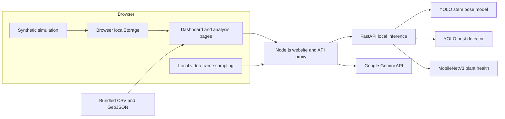

# Nabta

**A local field-operations dashboard for robot simulation, weed-stem detection, pest video analysis, plant-health classification, and agricultural assistance.**

Nabta explores precision laser weeding through two proposed platforms: **Nabta Roam**, an autonomous rover, and **Nabta Link**, a tractor-mounted implement. This repository implements the website, local model inference, and a synthetic field simulator. Physical robot control, calibrated field localization, and real laser treatment remain future integrations.

The interface supports **English, Arabic, and Japanese**, Arabic right-to-left layouts, and **light and dark themes**.

## Contents

- [Features and current status](#features-and-current-status)
- [Architecture](#architecture)
- [Requirements](#requirements)
- [Quick start](#quick-start)
- [Configuration](#configuration)
- [Model installation](#model-installation)
- [Using the application](#using-the-application)
- [Data and exports](#data-and-exports)
- [API reference](#api-reference)
- [Project structure](#project-structure)
- [Development and verification](#development-and-verification)
- [Troubleshooting](#troubleshooting)
- [Privacy and deployment boundaries](#privacy-and-deployment-boundaries)
- [Roadmap](#roadmap)
- [Attribution and licensing](#attribution-and-licensing)

## Features and current status

| Feature | Implemented behavior | Dependency |
| --- | --- | --- |
| Field dashboard | Survey totals, species outcomes, route statistics, density hotspots, and alerts | Bundled data or completed browser-saved simulation |
| Robot simulation | Synthetic plants, autonomous route, adaptive speed, virtual laser hits, GPS, and density mapping | Browser only |
| Weed detection | Uploaded-video playback with boxes and one stem keypoint per object | Python service and compatible YOLO pose checkpoint |
| Pest diagnostics | Caterpillar detection, frame-level summaries, and optional Gemini interpretation | Separate pest checkpoint; Gemini key for interpretation |
| Plant health | Crop-specific leaf classification with confidence, alternatives, and uncertainty indication | MobileNetV3-Large deployment bundle |
| Agriculture Assistant | Gemini chat using a compact survey summary and conversation history | Gemini API key and internet |
| Field data | Search, filters, and paginated weed/route/density tables | Survey files |
| Presentation | Shared sidebar, responsive layouts, saved theme/language preferences | Browser storage for persistence |

**Simulation and video inference are separate workflows.** The simulator generates its own plants and ideal GPS; it does not execute the trained detection model. Uploaded video produces image-space detections; it does not automatically generate a GPS field map or actuate hardware.

## Architecture



- **Frontend:** plain HTML/CSS/JavaScript, Bootstrap 5, Bootstrap Icons, ApexCharts, and flatpickr. No frontend build step.
- **Website/API:** Node.js built-in modules and `fetch`. The current application does not require `npm install`.
- **Inference:** Python, FastAPI, Uvicorn, Ultralytics, PyTorch, torchvision, and Pillow.
- **Assistant:** Gemini `generateContent` REST API; model and key are configured server-side.
- **Storage:** bundled files and browser localStorage. No application database or real robot telemetry bridge is implemented.

Node defaults to `127.0.0.1:3000`; Python inference defaults to `127.0.0.1:8091`. If an inference request cannot reach Python, Node attempts to launch `inference/server.py`. Loading and warm-up may take several seconds; repeated process-start attempts are throttled.

### Pipeline documents

- [Complete pipeline image](documentation/nabta-project-pipeline-gemini.png)
- [Detailed pipeline PDF](documentation/nabta-project-pipeline-gemini.pdf)
- [Original template documentation](documentation/index.html)

The pipeline separates implemented software from proposed robot hardware and field validation.

## Requirements

| Component | Requirement |
| --- | --- |
| Node.js | **22 or newer**; the server uses native `.env` loading |
| Browser | Modern browser with Canvas, localStorage, and local video decoding; H.264 MP4 is a practical starting format |
| Python | **3.11 recommended** for local inference |
| GPU | Optional; compatible CUDA-enabled PyTorch can accelerate inference, otherwise CPU is used |
| Trained weights | Required only for their corresponding inference features; not included in Git |
| Gemini key | Required only for assistant chat and optional pest interpretation |
| Internet | Required for Gemini and initial dependency installation; the stylesheet also requests Google Fonts, with fallback fonts available |

The dashboard, bundled survey review, and synthetic simulation work without Python, model weights, or an AI key.

## Quick start

### 1. Clone or update

```powershell
git clone --branch dashboard https://github.com/hathami22/F-AI-R_KIZUNA.git
cd F-AI-R_KIZUNA
```

For an existing checkout, inspect local changes before updating:

```powershell
git status
git pull --ff-only
```

### 2. Configure Gemini, if needed

For a new checkout without `.env`:

```powershell
Copy-Item .env.example .env
notepad .env
```

If `.env` already exists, edit it directly. Copying over it replaces local settings.

```dotenv
GEMINI_API_KEY=your_gemini_api_key
GEMINI_MODEL=gemini-3.5-flash-lite
```

Create a key in [Google AI Studio](https://aistudio.google.com/apikey). OpenAI keys are not used by this integration. Leave the Gemini key blank for non-assistant features.

### 3. Start the website

```powershell
node server.js
```

Open **http://localhost:3000**. The terminal reports the address and whether a Gemini key is configured without printing its value. Keep the terminal running; stop with **Ctrl+C**.

Restart after changing `.env`, editing server code, or replacing an already-loaded model bundle.

### 4. Install Python inference, if needed

Windows virtual environment setup without requiring activation scripts:

```powershell
python -m venv .venv
.\.venv\Scripts\python.exe -m pip install -r inference/requirements.txt
$env:NABTA_PYTHON = (Resolve-Path .\.venv\Scripts\python.exe).Path
node server.js
```

The interpreter setting above lasts for that PowerShell session. To persist it, put an absolute path in `.env`:

```dotenv
NABTA_PYTHON="C:/path/to/F-AI-R_KIZUNA/.venv/Scripts/python.exe"
```

Linux/macOS equivalent:

```bash
python3 -m venv .venv
.venv/bin/python -m pip install -r inference/requirements.txt
NABTA_PYTHON="$PWD/.venv/bin/python" node server.js
```

Install at least one model as described below, then open its page and wait for readiness. Gemini and local inference have independent runtime dependencies.

### Static-only preview

```powershell
python -m http.server 8000
```

Open `http://localhost:8000` for static pages, bundled data, and simulation. This command does not implement `/api/*`; chat and model inference require the Node server.

## Configuration

Node loads `.env` from the repository directory. Existing process environment variables take precedence. Python processes started by Node inherit those settings.

| Variable | Default | Purpose |
| --- | --- | --- |
| `GEMINI_API_KEY` | Unset | Server-side Gemini credential |
| `GEMINI_MODEL` | `gemini-3.5-flash-lite` | Gemini model ID; optional leading `models/` is removed |
| `HOST` | `127.0.0.1` | Website bind address |
| `PORT` | `3000` | Website port |
| `NABTA_PYTHON` | `python` | Interpreter used to start inference |
| `NABTA_DETECTION_PORT` | `8091` | Python inference port used by both services |
| `NABTA_MODEL_PATH` | `models/best.pt` | Weed/stem pose checkpoint |
| `NABTA_PEST_MODEL_PATH` | `models/pest_best.pt` | Pest detection checkpoint |
| `NABTA_DISEASE_MODEL_DIR` | `models/plant_disease` | Complete plant-health bundle directory |

Use absolute paths for custom model/interpreter locations and quote paths containing spaces. Restart to apply changes.

To change the website port temporarily:

```powershell
$env:PORT = "3086"
node server.js
```

Then open `http://localhost:3086`. A different host name or port is a different browser origin, with separate saved simulations and preferences.

`.env` and `.env.*` are ignored by Git; `.env.example` is explicitly allowed and must contain blank/example settings only. The Node static-file handler blocks hidden paths, including `.env`.

## Model installation

[inference/requirements.txt](inference/requirements.txt) pins Ultralytics to `8.4.216` and bounds FastAPI/Uvicorn versions. PyTorch, torchvision, and Pillow are also imported by the inference code and are supplied through the ML dependency stack. Keep PyTorch and torchvision builds compatible when configuring CUDA.

Expected local layout:

```text
models/
  best.pt                                      # optional weed/stem model
  pest_best.pt                                 # optional pest detector
  plant_disease/
    model_config.json
    class_to_idx.json
    plant_to_classes.json
    class_info.json
    mobilenetv3_large_robust_weights.pth         # install separately
```

Metadata JSON files are tracked. `.pt` files directly under `models/` and `.pth` weights under `models/` are excluded from Git. Cloning does not download checkpoints.

### Weed/stem pose checkpoint

Install at `models/best.pt` or set `NABTA_MODEL_PATH`. The service requires a YOLO **pose** model with keypoint shape **`[1, 3]`**: one stem point with x, y, and confidence information. A bounding-box-only detector or a human-pose checkpoint is not interchangeable.

Labels come from the checkpoint. The current video interface styles `onion` and `baby-onion` as crops and other detections as weeds. A different class taxonomy may require adjustments in `assets/js/weed-detection.js`.

### Caterpillar checkpoint

Install a valid YOLO object-detection checkpoint at `models/pest_best.pt`, or set `NABTA_PEST_MODEL_PATH`. The project workflow expects the trained `caterpillar` label. This checkpoint is independent of the weed pose model.

If a download is an archive containing a checkpoint, install the actual checkpoint. Renaming an arbitrary archive to `.pt` does not convert it into a model.

### Plant-health bundle

Place the `.pth` weights alongside their four matching JSON files, or set `NABTA_DISEASE_MODEL_DIR` to another complete bundle. The included configuration specifies:

- **MobileNetV3-Large**, **24 classes**, and five supported crops: Apple, Corn, Grape, Tomato, Strawberry.
- Resize short side to 256 pixels, then center-crop to **224 x 224**.
- Normalization and temperature calibration from `model_config.json`.
- A **0.60 confidence threshold** for the uncertainty flag.

Confidence is calculated within the selected crop's classes. Selecting the wrong crop changes the interpretation. The configuration states that training used PlantVillage with background randomization and **has not been validated on field images**.

At least one model must load for Python inference to start. A missing checkpoint disables that feature; an incompatible pose/pest checkpoint can fail startup validation for the shared service.

## Using the application

### Dashboard

Use the **Dashboard survey** selector to choose bundled files or the latest completed simulation saved in this browser. Review detections, route distance, species outcomes, density hotspots, and alerts.

The survey files record elapsed seconds. The date picker selects a reporting period for presentation; it does not turn those seconds into calendar timestamps or filter a multi-day dataset.

### Robot simulation

1. Open **Robot Simulation** and select **Start survey**.
2. Pause/resume or change playback speed as needed.
3. Expand **Survey settings** to adjust laser capacity or GPS origin. Applying an origin resets the run.
4. Toggle route, crop-stem, and ground-truth layers.
5. Click a map cell, or focus the map and use arrow keys, to inspect position and density.
6. Export current results at any time. After completion, choose **Use run in dashboard**, then open the dashboard.

The synthetic field is **40 x 24 m**, with a **2 m swath**, twelve rows, a **1.20 m/s** maximum target speed, and **2 pulses/s** default treatment capacity. The initial planning rule is:

```text
target speed = min(1.20, capacity / max(0.01, look-ahead density x swath))
```

Queued-target backlog, end-of-row braking, acceleration limits, and row changes further affect motion. Virtual treatment excludes targets within **0.15 m** of a crop stem. GPS is an ideal projection around an editable example origin near Tunis.

Each synthetic plant has a stable ID and is counted once. Grid density uses unique detections divided by surveyed area; unsurveyed cells export `null`. A virtual hit is an assumed outcome, not a real laser pulse or measured weed mortality.

### Weed video detection

1. Open **Weed Detection** and wait for **Model ready**.
2. Choose a browser-decodable video, such as H.264 MP4.
3. Select confidence and 640- or 1024-pixel inference.
4. Select **Start detection**; pause or seek to inspect another segment.

The browser retains the video, samples frames, sends them through Node to Python, and draws returned boxes and stem points. Yellow stem markers require keypoint confidence of at least 30%.

Playback follows inference at up to **12 sampled frames per video second**. CPU processing can slow playback significantly. This is processing-paced playback, not guaranteed original-video frame rate or a live-camera integration. Counts across frames can repeat the same plant.

### Pest video diagnostics

Run **Pest Video Diagnostics** on an uploaded video to obtain sampled-frame counts, frame-level detections, per-class presence, and scores. These are not unique insect counts or confirmed species/damage diagnoses.

With Gemini configured, **Generate AI diagnostic** sends only the compact report for interpretation; video frames are not sent to Gemini. Local detection does not require a Gemini key.

### Plant health

Choose a JPEG/PNG/WebP leaf photo and crop, then select **Analyze leaf**. Center the relevant leaf because preprocessing crops the image center. Inputs are limited to **8 MB and 16 megapixels**.

Results include a candidate condition, within-crop confidence, up to three alternatives, inference time, and uncertainty messaging. Verify results against the plant and growing conditions.

### Agriculture Assistant

Ask about the selected survey or general agricultural questions. The browser sends a bounded conversation and compact survey context to Node, which calls Gemini and returns the answer in the selected response language.

The instructions distinguish synthetic data from real observations, avoid inventing missing measurements, and treat detector outputs as unverified. They do not prescribe pesticide products, mixtures, doses, or application instructions.

Assistant readiness indicates that a key is **configured**. It does not validate the key, quota, billing, regional eligibility, or model access; those are determined when the provider processes a request.

### Themes, languages, and navigation

- Select English, Arabic, or Japanese in the header. Arabic mirrors layout while maps, coordinates, video, and numeric controls retain their spatial direction.
- Use the sun/moon button for light/dark mode. Initially the theme follows the device setting; an explicit choice is saved.
- Language/theme choices synchronize across tabs on the same origin without restarting active simulation or video playback.
- The sidebar is shared across pages and preserves desktop collapse state.
- Unknown interface messages fall back to English. The translation adapter does not rewrite user chat or generated assistant prose.

### Pages

| File | Purpose |
| --- | --- |
| `index.html` | Field dashboard |
| `simulation.html` | Synthetic robot survey |
| `weed-detection.html` | Video weed/stem pose inference |
| `pest-detection.html` | Pest detection and optional AI report |
| `plant-health.html` | Leaf-condition classification |
| `field-data.html` | Weed, route, and density tables |
| `field-assistant.html` | Gemini agriculture chat |
| `ui-forms.html` | Survey filters and template form examples |
| `ui-buttons.html` | Survey alerts and template UI examples |
| `tables-basic.html` | Original template table examples |
| `page-login.html`, `page-404.html`, `page-blank.html` | Template demonstration pages |

The login page implements UI and client-side validation, not accounts, sessions, or authentication for the application.

## Data and exports

Bundled data lives in `assets/data/`:

| File | Content |
| --- | --- |
| `simulated_weed_gps.csv` | Unique synthetic weed observations and treatment status |
| `simulated_gps_route.csv` | Synthetic positions and actual/target speeds |
| `simulated_field_density.geojson` | Field, density cells, weed points, and route |

CSV headers:

```text
# Weed observations
id,species,seconds,longitude,latitude,x,y,status,treated_seconds

# GPS route
seconds,longitude,latitude,speed_m_s,target_m_s,x_m,y_m
```

`seconds` and `treated_seconds` are elapsed time. Coordinates are simulated WGS84; local x/y values are meters and speed values are meters/second. `status` is `queued`, `treated`, `crop-protected`, or `missed`; treatment time is blank when not applicable.

GeoJSON is a `FeatureCollection` with `kind` values `field`, `density`, `weed`, and `route`. Density properties include `surveyed_m2`, `unique_weeds`, and `weeds_per_m2`. Generated features are marked `simulated: true`; coordinate order is **longitude, latitude**.

Exports use the same three filenames. The website does not currently offer a general-purpose real-survey import workflow.

### Browser persistence

| localStorage key | Content |
| --- | --- |
| `nabta.simulation.v1` | Selected source and latest completed simulation |
| `nabta.language` | UI language |
| `nabta.theme` | Explicit theme choice |
| `nabta.sidebarMinimized` | Desktop sidebar state |

Saved runs belong to the current browser origin, not a shared server database. Clearing site data removes them. Export CSV/GeoJSON to retain a copy outside localStorage.

## API reference

Browser-facing routes are served by Node on the website port:

| Method | Route | Request / result |
| --- | --- | --- |
| `GET` | `/api/health` | Assistant configuration: `ready`, `provider`, `model` |
| `POST` | `/api/assistant` | JSON conversation/context/language; returns `reply` or error |
| `GET` | `/api/detection/health` | Weed pose readiness, device, classes, keypoints |
| `POST` | `/api/detection/frame` | Raw image; returns dimensions, boxes, stem points, inference time |
| `GET` | `/api/pest-detection/health` | Pest readiness, device, classes |
| `POST` | `/api/pest-detection/frame` | Raw image; returns boxes, scores, inference time |
| `GET` | `/api/plant-health/health` | Classifier readiness, crops, confidence threshold |
| `POST` | `/api/plant-health/predict?plant=Tomato` | Raw image; returns condition, confidence, alternatives, validation note |

Weed/pest frame routes accept `confidence` from `0.05` to `0.95` and `image_size` of `640` or `1024`; defaults are `0.25` and `1024`. Image bodies are **raw bytes**, not multipart forms or JSON/base64 wrappers.

For example, after the pose model has loaded:

```powershell
Invoke-RestMethod -Uri http://localhost:3000/api/detection/health
Invoke-RestMethod -Method Post `
    -Uri "http://localhost:3000/api/detection/frame?confidence=0.25&image_size=640" `
    -ContentType "image/jpeg" `
    -InFile .\frame.jpg
```

The frame response includes `width`, `height`, `inference_ms`, and `detections`.
Each pose detection contains `class_id`, `class_name`, `confidence`, a
`box: [x1, y1, x2, y2]` in image pixels, and `stem` with x/y/confidence or `null`.
These are image coordinates, not ground or GPS coordinates. Pest detections have
boxes and scores without a stem keypoint.

### Assistant request example

```powershell
Invoke-RestMethod -Uri http://localhost:3000/api/health

$request = @{
    messages = @(@{ role = "user"; content = "Summarize the survey priorities." })
    fieldContext = "Synthetic survey example; not live field monitoring."
    language = "en"
} | ConvertTo-Json -Depth 6

Invoke-RestMethod -Method Post `
    -Uri http://localhost:3000/api/assistant `
    -ContentType "application/json" `
    -Body $request
```

The POST makes a real Gemini request when configured and is subject to provider quotas/billing. The context is illustrative; the UI normally constructs it from the selected survey.

Assistant limits:

- JSON body: **20 KiB** maximum.
- **1-10** messages, with `user`/`assistant` roles, **1-5,000** characters per message, and **10,000** total message characters.
- Context truncated to **6,000** characters.
- Language allowlist: `en`, `ar`, `ja`; other values use English.
- **12 requests/minute per remote address**, **45-second** upstream timeout, and `maxOutputTokens: 2048`.

Assistant turns map to Gemini `model` turns. The server returns usable text from the first candidate and excludes thought parts. Error codes include `invalid_credentials`, `access_denied`, `project_setup_required`, `model_unavailable`, `quota_or_rate_limit`, `service_unavailable`, and `empty_response`.

Gemini quota/rate-limit failures return HTTP 429 and may include `Retry-After`. Provider service unavailability returns 503; other upstream failures generally return 502. Raw provider diagnostics and API keys are not returned to the browser.

### Internal inference API

Python binds to loopback and exposes `/health`, `/frame`, `/pest/frame`, and `/disease/predict`. FastAPI docs/OpenAPI endpoints are disabled. A shared lock serializes inference; concurrent work can return HTTP 429.

Node limits encoded images to **8 MB**; Python enforces **16 megapixels** after decoding. The proxy has a 3-second inference-health timeout and a 120-second inference-request timeout, separate from Gemini's timeout.

## Project structure

```text
F-AI-R_KIZUNA/
  server.js                         Website, Gemini proxy, inference lifecycle
  .env.example                      Safe configuration template
  .env                              Local settings/secrets; untracked
  index.html                        Dashboard
  simulation.html                   Robot simulator
  weed-detection.html               Weed/stem video analysis
  pest-detection.html               Pest video analysis
  plant-health.html                 Leaf classification
  field-data.html                   Survey tables
  field-assistant.html              Assistant chat
  assets/
    css/                            Shared theme, RTL, feature styles
    js/
      sidebar.js                    Shared navigation
      theme.js                      Theme persistence and chart palettes
      i18n.js                       Locale selection and translation adapter
      translations.js               English/Arabic/Japanese catalog
      field-data.js                 Parsing, summaries, survey persistence
      field-dashboard.js            KPIs and charts
      field-simulation-engine.js    Simulation state and geometry
      field-simulation.js           Simulator UI and canvas rendering
      weed-detection.js             Shared weed/pest video processing
      plant-health.js               Leaf upload/results
      agri-assistant.js             Chat, history, survey context
    data/                           Bundled synthetic CSV/GeoJSON
    images/                         Branding and template images
    libs/                           Vendored browser libraries
  inference/
    requirements.txt                Python dependencies
    server.py                       FastAPI inference endpoints
    plant_disease.py                MobileNetV3 classifier
  models/                           Local weights and tracked health metadata
  tests/gemini-assistant.test.cjs    Mocked integration tests
  tools/generate_pipeline.py        Pipeline PDF/PNG generator
  documentation/                    Pipeline artifacts and template docs
```

## Development and verification

### Integration tests

```powershell
node --test tests/gemini-assistant.test.cjs
```

The native Node suite uses mocked Google responses and a disposable local server. It requires no real key and makes no paid Gemini calls. It covers configuration metadata, conversation roles, language/context instructions, text parsing, exclusion of thought text, credential/permission/model/billing/quota/service errors, retry guidance, malformed/blocked/empty replies, and missing Gemini configuration.

Ignored fixtures are written under `.playwright-cli/`. The suite does not validate model accuracy, GPU performance, real provider availability, or robot hardware.

### Syntax checks

```powershell
node --check server.js
node --check assets/js/agri-assistant.js
node --check assets/js/weed-detection.js
python -m py_compile inference/server.py inference/plant_disease.py
git diff --check
```

### Regenerate pipeline documents

```powershell
python -m pip install reportlab pypdfium2 pypdf
python tools/generate_pipeline.py
```

The script writes Gemini-version PDF/PNG files into `documentation/` and review renders into `.playwright-cli/`. `.gitattributes` preserves PDF/PNG bytes during Windows checkouts.

### Frontend conventions

- Maintain navigation in `sidebar.js`, rather than duplicating it per page.
- Add new messages and Arabic/Japanese equivalents to `translations.js`; use parameterized messages for changing values.
- Respect `data-theme`, `data-bs-theme`, and `dir`. Keep plot colors and legends synchronized.
- Check desktop/mobile layouts, keyboard access, theme persistence, and Arabic RTL behavior.
- Keep API keys, model IDs, coordinate order, and export schemas independent of translated labels.

There is no npm build pipeline, database migration process, or automated training job in this repository. Training/export and physical hardware integration are separate workstreams.

## Troubleshooting

| Symptom | Check / action |
| --- | --- |
| `process.loadEnvFile is not a function` | Use Node.js 22+; verify which executable the terminal runs |
| Port already in use | Stop the old instance or select another `PORT`, then use the matching URL |
| Assistant key missing | Set `GEMINI_API_KEY` in `.env`, check environment overrides, restart Node |
| Assistant ready but chat fails | Readiness checks configuration only; inspect the returned error code |
| Gemini credentials/access rejected | Check key restrictions, project permissions, billing/setup, and regional availability in Google AI Studio |
| Model unavailable | Set `GEMINI_MODEL` to a model available to the key's project |
| Gemini HTTP 429 | Check quotas/rate limits/billing; respect `Retry-After`. Rapid retries do not replenish quota |
| Python not found | Set `NABTA_PYTHON` to the interpreter with the inference dependencies installed |
| Inference keeps starting or returns 503 | Allow cold start; inspect Python logs, imports, paths, and checkpoint validation |
| No checkpoints found | Install at least one supported checkpoint/bundle; Git does not include weights |
| Wrong pose keypoint shape | Use the trained one-stem pose checkpoint `[1, 3]`, not a detector/human-pose model |
| Plant-health model cannot load | Match the four JSON files and `.pth` weights; check class count and PyTorch/torchvision compatibility |
| One detector unavailable | That feature's separate checkpoint may be absent even if another model is ready |
| Video will not decode | Try H.264 MP4; SVO files need external conversion before this browser workflow |
| Slow playback | Try 640-pixel inference, avoid concurrent inference, verify CUDA availability |
| Inference HTTP 429 | Another request holds the shared model lock; finish/pause it before retrying |
| Image rejected | Check 8 MB encoded size, 16-megapixel decoded size, and supported format |
| Saved run missing | Check the browser profile and exact host/port; clearing site data removes browser storage |
| APIs fail in static preview | Start Node rather than only `python -m http.server` |
| Text remains English | Add the missing interface message to the catalog; generated chat is intentionally not rewritten by the DOM adapter |

Check CUDA using the interpreter selected for inference:

```powershell
.\.venv\Scripts\python.exe -c "import torch; print('CUDA available:', torch.cuda.is_available())"
```

An installed NVIDIA GPU alone does not mean the installed PyTorch build supports CUDA.

## Privacy and deployment boundaries

- Gemini keys stay in the server environment; they are not embedded in frontend code or committed in `.env.example`.
- Chat questions and compact survey context go to Google Gemini. Pest interpretation sends summary data, not video frames. Provider-side handling follows Google's API terms and project settings.
- Uploaded video remains in the browser. Sampled frames and leaf photos are processed in memory by local inference; the application does not implement server-side media archival.
- Conversation history lives in the current page session. Completed synthetic runs and preferences use localStorage, not a database.
- Static serving blocks hidden paths, `server.js`, `models/`, and `inference/`.
- This local prototype has no implemented authentication/authorization. The template login does not protect APIs. Exposing it beyond loopback requires an authenticated deployment layer; HTTPS and access control are not supplied by this demo.

## Roadmap

1. Validate weed/stem perception on representative held-out field footage.
2. Develop one enclosed treatment channel with calibrated targeting and measured biological efficacy.
3. Synchronize camera, GNSS, heading, and motion; project stems onto the ground and associate plants across frames.
4. Integrate **Nabta Roam** navigation/drivetrain or **Nabta Link** mounting and operator speed guidance. Tractor speed control requires a compatible integration.
5. Add a real telemetry bridge, durable run storage, and explicit separation of physical and synthetic surveys.
6. Measure weed mortality, crop injury, throughput, energy, labor, and downtime in field trials.

The current software does not measure irrigation savings, energy/hectare, real weed mortality, or autonomous-hardware reliability. Those require separate evidence before making production-performance or resource-saving claims.

## Attribution and licensing

The dashboard is based on **Spark Admin** by Spark Admin Dev and its development team, distributed by **ThemeWagon**. The original template attribution identifies MIT licensing; this checkout currently has no standalone `LICENSE` file.

- [Spark Admin](https://sparkadminpro.gumroad.com/)
- [ThemeWagon](https://themewagon.com/)

Vendored libraries and model artifacts retain their own terms. Checkpoints are installed separately and are not redistributed here. Retain original attribution and verify the applicable library, asset, and checkpoint terms for your distribution.
